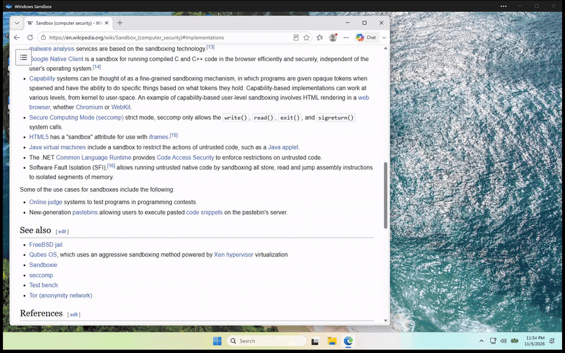

# winbox

**Watch your AI agent use a real Windows desktop, the way a person would.**

winbox gives Claude Code, Codex or any other MCP client its own Windows desktop inside
[Windows Sandbox](https://learn.microsoft.com/windows/security/application-security/application-isolation/windows-sandbox/windows-sandbox-overview).
You sit back and watch it work: the cursor glides across the screen, clicks land with a ripple, text appears key
by key, and a caption at the bottom tells you what it's doing. It browses, opens apps and fills in forms like a
human at the keyboard, while your own mouse, keyboard and clipboard stay yours.


*Real recording, real time: the agent opens Edge, goes to Wikipedia, searches and reads. The violet halo and the
caption pill show what it's doing.*

<details>
<summary>Another run: browsing umich.edu (pauses while the agent read screenshots trimmed)</summary>



MP4 versions: [Wikipedia run](docs/demo-wikipedia.mp4), [umich.edu run](docs/demo-umich.mp4).
</details>

> **Status: v0.1, early.** Tested end to end in a real Windows Sandbox on Windows 11 Pro: the cursor animation,
> human-paced typing, the overlay and captions, clicks, typing and scrolling in Edge all work. Expect rough edges,
> and please [open an issue](https://github.com/raman2221/winbox/issues) when something breaks.

## What you see

Most automation teleports the mouse and pastes text in an instant, which is impossible to follow. winbox makes the
agent's work watchable:

- **The agent tells you what it's doing, in its own words.** Every input tool takes an optional `intent`, a short
  phrase such as "Opening the Start menu" or "Searching for flights". A caption pill at the bottom of the sandbox
  screen shows it for the whole action, so you follow the agent's *plan*, not just its clicks. Without an intent
  the pill falls back to a plain description: "Clicking", "Typing “hello”", "Pressing ctrl+l", "Opening msedge".
  From the CLI, add `--why "<text>"` to any input command.
- **A cursor that moves like a hand.** The pointer glides along an eased, slightly curved path instead of jumping.
  Short hops take about 180 ms and long sweeps up to about 650 ms.
- **Typing you can read.** Text goes in one key at a time, with 25 to 75 ms between keys and a small extra pause at
  each space.
- **An overlay that shows where it's working.** While the agent is active, a violet halo follows its cursor and a
  ripple marks every click.
- **Clean screenshots for the agent.** The overlay windows are marked with
  `SetWindowDisplayAffinity(WDA_EXCLUDEFROMCAPTURE)`, so people watching see them but the agent's screenshots don't
  include them. They're also click-through, so they never get in the way of input.

The best seat is the **native Windows Sandbox window**: full resolution, smooth, and right on your desktop. If you'd
rather stay in the terminal, `winbox view` streams the screen into Windows Terminal as Sixel graphics.

## Why

Computer-use agents are useful, but letting one drive *your* desktop is awkward: it grabs your cursor, types into
whatever window has focus, and can see everything you have open. winbox gives the agent a separate machine instead.

- **Separate desktop.** The agent works in its own Windows session inside Windows Sandbox, not on your screen.
- **Hands off your input.** The agent never moves the host's mouse, presses the host's keys or reads the host's
  clipboard. Clipboard, microphone, camera and printer redirection are switched off.
- **Easy to follow, easy to step in.** Watch in the Sandbox window, or use `winbox view` in Windows Terminal, where
  your clicks and typing pass through to the sandbox.
- **Clean every time.** Windows Sandbox is disposable. Close it and everything inside is gone.
- **Nothing to install in the guest.** The guest helper targets .NET Framework 4.8, which Windows Sandbox already
  ships with.

## Requirements

- Windows 10 or 11 **Pro, Enterprise or Education**. Windows Home doesn't include Windows Sandbox.
- Virtualization enabled in your BIOS/UEFI.
- About 4 GB of free RAM.
- Windows Sandbox turned on. In an **administrator** PowerShell:

  ```powershell
  Enable-WindowsOptionalFeature -Online -FeatureName Containers-DisposableClientVM -All
  ```

  Then restart your PC.
- Optional: [Windows Terminal](https://aka.ms/terminal) 1.22 or newer, if you want to watch with `winbox view`.
  Older terminals can't show Sixel. The native Sandbox window needs nothing extra.

## Install

### One-liner (recommended)

In a normal (non-admin) PowerShell:

```powershell
irm https://github.com/raman2221/winbox/releases/latest/download/install.ps1 | iex
```

The installer downloads the latest release zip, checks its SHA-256 hash, extracts it to
`%LOCALAPPDATA%\Programs\winbox` and adds that folder to your *user* PATH. It doesn't need admin rights. Open a new
terminal afterwards so the PATH change takes effect.

### Manual zip

1. Download `winbox-win-x64.zip` and `winbox-win-x64.zip.sha256` from the
   [latest release](https://github.com/raman2221/winbox/releases/latest).
2. Check the hash: `(Get-FileHash .\winbox-win-x64.zip -Algorithm SHA256).Hash` should match the `.sha256` file
   (PowerShell prints it in upper case; the file has it in lower case).
3. Extract the zip anywhere and add that folder to your PATH. Keep the `guest` folder next to `winbox.exe`.

### Build from source

You need the [.NET 10 SDK](https://dotnet.microsoft.com/download) and, for the guest helper, the .NET Framework 4.8
targeting pack (included with Visual Studio's .NET desktop workload, or install the .NET Framework 4.8 Developer Pack).

```powershell
git clone https://github.com/raman2221/winbox
cd winbox
dotnet build winbox.slnx -c Release
.\scripts\package.ps1   # optional: self-contained build + zip + sha256 in dist\
```

## Quick start

```powershell
winbox setup                         # check your PC can run Windows Sandbox and how to fix it if not
winbox start                         # boot the sandbox; its window opens on your desktop
winbox status                        # is the guest helper alive?
winbox view                          # optional: watch and drive it from Windows Terminal instead
winbox screenshot shot.png           # grab the sandbox screen
winbox run msedge --why "Opening Edge"        # launch a program; the caption says why
winbox type "hello from the host"
winbox stop                          # close the sandbox (and wipe it)
```

## Use it with Claude Code

Register the MCP server. `winbox mcp-config` prints the exact command for your install:

```powershell
winbox mcp-config
# Claude Code:
#
#     claude mcp add winbox -- "C:\Users\you\AppData\Local\Programs\winbox\winbox.exe" mcp
#
# ...followed by the same server as an mcpServers JSON block for other clients.
```

Run the printed command, then ask Claude to do something in the sandbox. It can call `start_sandbox` itself if the
sandbox isn't running yet.

For better results, install the bundled skill, which teaches the agent an observe, act, verify loop:

```powershell
$skill = "$HOME\.claude\skills\winbox"
$url = 'https://raw.githubusercontent.com/raman2221/winbox/main/skills/winbox/SKILL.md'
New-Item -ItemType Directory -Force $skill | Out-Null
Invoke-WebRequest $url -OutFile "$skill\SKILL.md" -UseBasicParsing
```

From a clone of this repo you can copy it instead: `Copy-Item .\skills\winbox\SKILL.md "$skill\SKILL.md"`.

## Use it with other MCP clients

winbox speaks MCP over stdio. Point your client at `winbox.exe` with the argument `mcp`.

A typical JSON config (Claude Desktop, Cursor and others):

```json
{
  "mcpServers": {
    "winbox": {
      "command": "C:\\Users\\you\\AppData\\Local\\Programs\\winbox\\winbox.exe",
      "args": ["mcp"]
    }
  }
}
```

Codex (`~/.codex/config.toml`):

```toml
[mcp_servers.winbox]
command = 'C:\Users\you\AppData\Local\Programs\winbox\winbox.exe'
args = ["mcp"]
```

Agents that read `AGENTS.md` or a skills folder can use [`skills/winbox/SKILL.md`](skills/winbox/SKILL.md) as
instructions.

### MCP tools

| Tool | What it does |
| --- | --- |
| `screenshot` | Capture the sandbox screen, sized for the model (see below). |
| `click(x, y, button="left", clicks=1, intent)` | Click at a point. `button` is `left`, `right` or `middle`; `clicks` is 1 to 3; `clicks=2` double-clicks. |
| `move_mouse(x, y, intent)` | Move the pointer, e.g. to reveal a tooltip. |
| `drag(fromX, fromY, toX, toY, intent)` | Press the left button, move and release. |
| `scroll(x, y, notches, intent)` | Scroll the wheel at a point. Positive is up, negative is down. |
| `type_text(text, intent)` | Type text into the focused window, one key at a time. Newlines press Enter. |
| `press_key(combo, intent)` | Press a key or chord, such as `enter`, `ctrl+l`, `alt+f4`, `win+r`. |
| `run_program(command, intent)` | Launch a program the way the Win+R Run dialog would. See the notes below. |
| `status` | Report whether the sandbox and guest helper are running, and the guest's real screen size. |
| `start_sandbox(memoryMb=4096, offline=false)` | Start Windows Sandbox with the guest helper. |
| `stop_sandbox` | Close the sandbox. Everything inside is wiped. |

Notes:

- **`intent` is optional on every input tool.** It's a short phrase shown to people watching; under about six
  words reads best. winbox flattens it to one line and cuts it off at 60 characters.
- **Screenshots are sized for the model.** The MCP `screenshot` shrinks the image to at most 1568 px on the long
  edge and about 1.15 megapixels, the size Claude would otherwise downscale it to. Input coordinates are pixels of
  the latest screenshot, measured from its top-left corner, and winbox maps them back to guest pixels for you.
  `status` reports the guest's real resolution, which can be larger than the screenshot. The CLI `screenshot`
  command always saves the full-size image.
- **`run_program` doesn't go through `cmd`.** winbox splits the line into a program and its arguments (a quoted
  program path such as `"C:\My Tools\app.exe" --flag` works) and starts it with ShellExecute, so app names
  resolve the way they do in the Run dialog. `&`, `|` and `%` reach the program literally, which keeps URLs
  intact. For shell features, ask for a shell: `cmd /c dir > out.txt`. A program that can't be found comes back
  as an error.

## CLI reference

| Command | Description |
| --- | --- |
| `winbox help` | List every command. Running `winbox` with no arguments does the same. |
| `winbox setup` | Check that this PC can run Windows Sandbox and explain how to enable it. |
| `winbox start [--memory <MB>] [--offline]` | Write the sandbox config and launch Windows Sandbox. `--offline` disables networking. |
| `winbox stop` | Shut the sandbox down from inside (`shutdown /s /f /t 1`). Open apps close without saving and everything is wiped. |
| `winbox status` | Show whether the sandbox and guest helper are running. |
| `winbox view` | Stream the sandbox screen into Windows Terminal. Clicks and typing pass through. |
| `winbox screenshot <out.png>` | Save a full-resolution screenshot of the sandbox. |
| `winbox click <x> <y> [left\|right\|middle] [--double]` | Click at a point. |
| `winbox move <x> <y>` | Move the pointer. |
| `winbox drag <x1> <y1> <x2> <y2>` | Drag from one point to another. |
| `winbox scroll <x> <y> <notches>` | Scroll at a point (positive is up). |
| `winbox type <text...>` | Type text. The remaining arguments are joined with spaces. |
| `winbox key <combo>` | Press a key combo, such as `ctrl+shift+esc`. |
| `winbox run <command line...>` | Launch a program inside the sandbox, e.g. `winbox run msedge`. Windows Sandbox has no Store apps (Notepad, Calculator); Edge, cmd, PowerShell and Explorer are there. Like `run_program`, no `cmd` is involved. |
| `winbox mcp` | Run the MCP server on stdio. |
| `winbox mcp-config` | Print the `claude mcp add` command for this install. |

Every input command (`click`, `move`, `drag`, `scroll`, `type`, `key`, `run`) also takes `--why <text>`, the CLI
version of the MCP `intent`, for example `winbox click 640 400 --why "Opening the Start menu"`. CLI coordinates are
guest pixels, the same as in a `winbox screenshot`.

## How it works

```
  HOST                                         WINDOWS SANDBOX (disposable)
 +---------------------------------+          +---------------------------------+
 |  agent --MCP--+                 |          |  LogonCommand starts            |
 |               v                 |          |  Winbox.Guest.exe               |
 |  you ----> winbox.exe           |          |    GDI screenshots              |
 |               |                 |          |    SendInput mouse/keyboard     |
 |               v                 |          |    launch programs              |
 |  %LOCALAPPDATA%\winbox\         |          |    overlay (halo, caption)      |
 |    winbox.wsb                   |          |                                 |
 |    tools\    ---- read-only ----------->   |  C:\winbox\tools                |
 |    control\  <--- read/write ---------->   |  C:\winbox\control              |
 |      requests\    host -> guest |          |                                 |
 |      replies\     guest -> host |          |                                 |
 |      guest.status heartbeat     |          |                                 |
 |      guest.log    helper errors |          |                                 |
 +---------------------------------+          +---------------------------------+
```

1. `winbox start` writes a `.wsb` config to `%LOCALAPPDATA%\winbox\`. It maps two host folders into the sandbox:
   `tools` (read-only, holds the guest helper `Winbox.Guest.exe`) at `C:\winbox\tools`, and `control` (read/write)
   at `C:\winbox\control`. Then it launches Windows Sandbox, whose LogonCommand starts the helper.
2. To act, the host drops a one-line text command into `control\requests\` as a `.req` file. When the agent
   gives an `intent`, a `say` request carrying that caption goes first, and the helper shows it for the action
   that follows.
3. The helper runs it: GDI screenshots, `SendInput` for mouse and keyboard, or launching a program. Mouse moves
   follow an eased path and typing is paced key by key, while a capture-excluded overlay draws the halo, click
   ripple and caption. It writes the reply, and any PNG, to `control\replies\`.
4. The helper refreshes `control\guest.status` every second, so the host can tell it's alive, and appends any
   errors it hits to `control\guest.log`.

winbox doesn't open any network connection between host and guest. The shared folders are its only channel.

### Project layout

| Project | Target | Role |
| --- | --- | --- |
| `src/Winbox.Protocol` | netstandard2.0 | Command format and control-folder layout, shared by host and guest. |
| `src/Winbox.Guest` | net48 | The helper that runs inside the sandbox. |
| `src/Winbox.Core` | net10.0-windows | Sandbox config, launching, the guest client and the Sixel renderer. |
| `src/Winbox.Cli` | net10.0-windows | `winbox.exe`: the CLI and MCP server. Ships the guest build in `guest\`. |
| `tests/Winbox.Core.Tests` | net10.0-windows, xunit | Host-side unit tests. |
| `tests/Winbox.Guest.Tests` | net48, xunit | Guest helper tests, on the runtime the helper ships on. |

## Security

- Windows Sandbox is a hardware-virtualized boundary. That's much stronger than running an agent on your own
  desktop, but no isolation is perfect.
- **Networking is on by default.** The guest can reach the internet *and your local network*. For untrusted tasks,
  start with `winbox start --offline` (or `start_sandbox(offline=true)`).
- Host clipboard, microphone, camera and printer redirection are disabled.
- The `control` folder is the one writable path between guest and host. Anything running in the sandbox can write
  files there.
- Don't give the agent real credentials or secrets to type into the sandbox. Anything typed there may be visible in
  screenshots and to software inside the guest.
- The sandbox is wiped when it closes. Copy out anything you want to keep before running `winbox stop`.

## Troubleshooting

- **Start with `winbox status`.** It tells you whether Windows Sandbox is running, whether the helper inside it
  responds, and the guest's screen size.
- **Read the helper's log.** Errors inside the sandbox are appended to `%LOCALAPPDATA%\winbox\control\guest.log`
  on the host. `winbox start` clears the control folder, so read it before you restart.
- **`winbox stop` says the helper isn't responding.** Stopping works by asking the helper to shut Windows down, so
  close the Windows Sandbox window yourself instead.
- **`winbox start` says a sandbox is already running.** Windows Sandbox allows one instance at a time. Close the
  open one first.
- **`run_program` can't find a program, or `&&` doesn't work.** There's no shell in between. Give the full path,
  or wrap the command in `cmd /c ...` when you need shell features.

## Limitations and roadmap

v0.1 limitations:

- One sandbox at a time, because Windows Sandbox only runs one instance.
- No persistence. Every start is a fresh Windows.
- `winbox view` needs a Sixel-capable terminal; Windows Terminal 1.22+ is the supported one.
- The human-like motion, typing rhythm, overlay and intent captions are untested in a real Sandbox so far.
  Timings may need tuning.
- Human pacing makes actions slower than raw automation; long text takes a few seconds to type.
- Agents see pixels only. There are no accessibility-tree snapshots yet.
- Not available on Windows Home.

Ideas for later (not promises):

- A Hyper-V backend for persistent VMs and multiple instances.
- An optional QEMU backend so Windows Home users can join in.
- Accessibility-tree snapshots alongside screenshots.

## Contributing

Bug reports, test results from real machines and pull requests are all welcome. See
[CONTRIBUTING.md](CONTRIBUTING.md) for build, test and code-style notes.

## License

[MIT](LICENSE) © 2026 raman2221

## Acknowledgements

winbox was inspired by [govijr/terminal-mac](https://github.com/govijr/terminal-mac), which does the same job for
macOS guests on Apple silicon.
