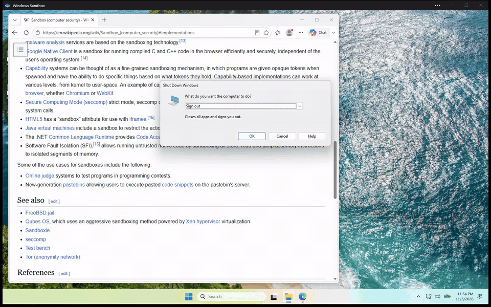

# winbox

**Watch your AI agent use a real Windows desktop, the way a person would.**

winbox gives Claude Code, Codex or any other MCP client its own Windows desktop inside
[Windows Sandbox](https://learn.microsoft.com/windows/security/application-security/application-isolation/windows-sandbox/windows-sandbox-overview).
You sit back and watch it work: the cursor glides across the screen, clicks land with a ripple, text appears key
by key, and a caption at the bottom tells you what it's doing. It browses, opens apps and fills in forms like a
human at the keyboard, while your own mouse, keyboard and clipboard stay yours.

<!--
  DEMO GIF GOES HERE (top priority before launch).
  Show: the native Windows Sandbox window, an agent opening Edge, typing a search and clicking a result,
  with the violet cursor halo, click ripples and the caption pill visible.
  
-->

> **Status: v0.1, early.** The pieces are built, but nothing has been run end to end inside a real Windows Sandbox
> yet, including the animated cursor, human-paced typing and on-screen overlay described below. Expect rough edges,
> and please [open an issue](https://github.com/raman2221/winbox/issues) when something breaks.

## What you see

Most automation teleports the mouse and pastes text in an instant, which is impossible to follow. winbox makes the
agent's work watchable:

- **A cursor that moves like a hand.** The pointer glides along an eased, slightly curved path instead of jumping.
  Short hops take about 180 ms and long sweeps up to about 650 ms.
- **Typing you can read.** Text goes in one key at a time, with 25 to 75 ms between keys and a small extra pause at
  each space.
- **An overlay that shows intent.** While the agent is active, a violet halo follows its cursor, a ripple marks
  every click, and a caption pill at the bottom of the screen says what's happening: "Clicking",
  "Typing “hello”", "Pressing ctrl+l", "Opening notepad".
- **Clean screenshots for the agent.** The overlay windows are marked with
  `SetWindowDisplayAffinity(WDA_EXCLUDEFROMCAPTURE)`, so people watching see them but the agent's screenshots don't
  include them. They're also click-through, so they never get in the way of input.

The best seat is the **native Windows Sandbox window**: full resolution, smooth, and right on your desktop. If you'd
rather stay in the terminal, `winbox view` streams the screen into Windows Terminal as Sixel graphics.

## Why

Computer-use agents are useful, but letting one drive *your* desktop is awkward: it grabs your cursor, types into
whatever window has focus, and can see everything you have open. winbox gives the agent a separate machine instead.

- **Separate desktop.** The agent works in its own Windows session inside Windows Sandbox, not on your screen.
- **Hands off your input.** The agent never moves the host's mouse, presses the host's keys or reads the host's
  clipboard. Clipboard, audio, camera and printer redirection are switched off.
- **Easy to follow, easy to step in.** Watch in the Sandbox window, or use `winbox view` in Windows Terminal, where
  your clicks and typing pass through to the sandbox.
- **Clean every time.** Windows Sandbox is disposable. Close it and everything inside is gone.
- **Nothing to install in the guest.** The guest helper targets .NET Framework 4.8, which Windows Sandbox already
  ships with.

## Requirements

- Windows 10 or 11 **Pro, Enterprise or Education**. Windows Home doesn't include Windows Sandbox.
- Virtualization enabled in your BIOS/UEFI.
- About 4 GB of free RAM.
- Windows Sandbox turned on. In an **administrator** PowerShell:

  ```powershell
  Enable-WindowsOptionalFeature -Online -FeatureName Containers-DisposableClientVM -All
  ```

  Then restart your PC.
- Optional: [Windows Terminal](https://aka.ms/terminal) 1.22 or newer, if you want to watch with `winbox view`.
  Older terminals can't show Sixel. The native Sandbox window needs nothing extra.

## Install

### One-liner (recommended)

In a normal (non-admin) PowerShell:

```powershell
irm https://github.com/raman2221/winbox/releases/latest/download/install.ps1 | iex
```

The installer downloads the latest release zip, checks its SHA-256 hash, extracts it to
`%LOCALAPPDATA%\Programs\winbox` and adds that folder to your *user* PATH. It doesn't need admin rights. Open a new
terminal afterwards so the PATH change takes effect.

### Manual zip

1. Download `winbox-win-x64.zip` and `winbox-win-x64.zip.sha256` from the
   [latest release](https://github.com/raman2221/winbox/releases/latest).
2. Check the hash: `(Get-FileHash .\winbox-win-x64.zip -Algorithm SHA256).Hash` should match the `.sha256` file.
3. Extract the zip anywhere and add that folder to your PATH. Keep the `guest` folder next to `winbox.exe`.

### Build from source

You need the [.NET 10 SDK](https://dotnet.microsoft.com/download).

```powershell
git clone https://github.com/raman2221/winbox
cd winbox
dotnet build winbox.slnx -c Release
.\scripts\package.ps1   # optional: self-contained build + zip + sha256 in dist\
```

## Quick start

```powershell
winbox setup                         # check your PC can run Windows Sandbox and how to fix it if not
winbox start                         # boot the sandbox; its window opens on your desktop
winbox status                        # is the guest helper alive?
winbox view                          # optional: watch and drive it from Windows Terminal instead
winbox screenshot shot.png           # grab the sandbox screen
winbox run notepad                   # launch a program inside the sandbox
winbox type "hello from the host"
winbox stop                          # close the sandbox (and wipe it)
```

## Use it with Claude Code

Register the MCP server. `winbox mcp-config` prints the exact command for your install:

```powershell
winbox mcp-config
# claude mcp add winbox -- "C:\Users\you\AppData\Local\Programs\winbox\winbox.exe" mcp
```

Run the printed command, then ask Claude to do something in the sandbox. It can call `start_sandbox` itself if the
sandbox isn't running yet.

For better results, install the bundled skill, which teaches the agent an observe, act, verify loop:

```powershell
New-Item -ItemType Directory -Force "$HOME\.claude\skills" | Out-Null
Copy-Item -Recurse .\skills\winbox "$HOME\.claude\skills\winbox"
```

## Use it with other MCP clients

winbox speaks MCP over stdio. Point your client at `winbox.exe` with the argument `mcp`.

A typical JSON config (Claude Desktop, Cursor and others):

```json
{
  "mcpServers": {
    "winbox": {
      "command": "C:\\Users\\you\\AppData\\Local\\Programs\\winbox\\winbox.exe",
      "args": ["mcp"]
    }
  }
}
```

Codex (`~/.codex/config.toml`):

```toml
[mcp_servers.winbox]
command = 'C:\Users\you\AppData\Local\Programs\winbox\winbox.exe'
args = ["mcp"]
```

Agents that read `AGENTS.md` or a skills folder can use [`skills/winbox/SKILL.md`](skills/winbox/SKILL.md) as
instructions.

### MCP tools

| Tool | What it does |
| --- | --- |
| `screenshot` | Capture the sandbox screen. |
| `click(x, y, button="left", clicks=1)` | Click at a point. `button` is `left`, `right` or `middle`; `clicks=2` double-clicks. |
| `move_mouse(x, y)` | Move the pointer. |
| `drag(fromX, fromY, toX, toY)` | Press, move and release. |
| `scroll(x, y, notches)` | Scroll the wheel at a point. Positive is up, negative is down. |
| `type_text(text)` | Type text into the focused window. |
| `press_key(combo)` | Press a key or chord, such as `enter`, `ctrl+l`, `alt+f4`, `win+r`. |
| `run_program(command)` | Launch a program or command inside the sandbox. |
| `status` | Report whether the sandbox and guest helper are running. |
| `start_sandbox(memoryMb=4096, offline=false)` | Start Windows Sandbox with the guest helper. |
| `stop_sandbox` | Close the sandbox. Everything inside is wiped. |

Coordinates are screen pixels measured from the top-left corner of the latest screenshot.

## CLI reference

| Command | Description |
| --- | --- |
| `winbox setup` | Check that this PC can run Windows Sandbox and explain how to enable it. |
| `winbox start [--memory <MB>] [--offline]` | Write the sandbox config and launch Windows Sandbox. `--offline` disables networking. |
| `winbox stop` | Close the sandbox. |
| `winbox status` | Show whether the sandbox and guest helper are running. |
| `winbox view` | Stream the sandbox screen into Windows Terminal. Clicks and typing pass through. |
| `winbox screenshot <out.png>` | Save a screenshot of the sandbox. |
| `winbox click <x> <y> [left\|right\|middle] [--double]` | Click at a point. |
| `winbox move <x> <y>` | Move the pointer. |
| `winbox drag <x1> <y1> <x2> <y2>` | Drag from one point to another. |
| `winbox scroll <x> <y> <notches>` | Scroll at a point (positive is up). |
| `winbox type <text>` | Type text. |
| `winbox key <combo>` | Press a key combo, such as `ctrl+shift+esc`. |
| `winbox run <command>` | Launch a program inside the sandbox. |
| `winbox mcp` | Run the MCP server on stdio. |
| `winbox mcp-config` | Print the `claude mcp add` command for this install. |

## How it works

```
  HOST                                         WINDOWS SANDBOX (disposable)
 +---------------------------------+          +---------------------------------+
 |  agent --MCP--+                 |          |  LogonCommand starts            |
 |               v                 |          |  Winbox.Guest.exe               |
 |  you ----> winbox.exe           |          |    GDI screenshots              |
 |               |                 |          |    SendInput mouse/keyboard     |
 |               v                 |          |    launch programs              |
 |  %LOCALAPPDATA%\winbox\         |          |    overlay (halo, caption)      |
 |    winbox.wsb                   |          |                                 |
 |    tools\    ---- read-only ----------->   |  C:\winbox\tools                |
 |    control\  <--- read/write ---------->   |  C:\winbox\control              |
 |      requests\    host -> guest |          |                                 |
 |      replies\     guest -> host |          |                                 |
 |      guest.status heartbeat     |          |                                 |
 +---------------------------------+          +---------------------------------+
```

1. `winbox start` writes a `.wsb` config to `%LOCALAPPDATA%\winbox\`. It maps two host folders into the sandbox:
   `tools` (read-only, holds the guest helper `Winbox.Guest.exe`) at `C:\winbox\tools`, and `control` (read/write)
   at `C:\winbox\control`. Then it launches Windows Sandbox, whose LogonCommand starts the helper.
2. To act, the host drops a one-line text command into `control\requests\`.
3. The helper runs it: GDI screenshots, `SendInput` for mouse and keyboard, or launching a program. Mouse moves
   follow an eased path and typing is paced key by key, while a capture-excluded overlay draws the halo, click
   ripple and caption. It writes the reply, and any PNG, to `control\replies\`.
4. The helper refreshes `control\guest.status` every second, so the host can tell it's alive.

winbox doesn't open any network connection between host and guest. The shared folders are its only channel.

### Project layout

| Project | Target | Role |
| --- | --- | --- |
| `src/Winbox.Protocol` | netstandard2.0 | Command format and control-folder layout, shared by host and guest. |
| `src/Winbox.Guest` | net48 | The helper that runs inside the sandbox. |
| `src/Winbox.Core` | net10.0-windows | Sandbox config, launching, the guest client and the Sixel renderer. |
| `src/Winbox.Cli` | net10.0-windows | `winbox.exe`: the CLI and MCP server. Ships the guest build in `guest\`. |
| `tests/Winbox.Core.Tests` | xunit | Unit tests. |

## Security

- Windows Sandbox is a hardware-virtualized boundary. That's much stronger than running an agent on your own
  desktop, but no isolation is perfect.
- **Networking is on by default.** The guest can reach the internet *and your local network*. For untrusted tasks,
  start with `winbox start --offline` (or `start_sandbox(offline=true)`).
- Host clipboard, audio, camera and printer redirection are disabled.
- The `control` folder is the one writable path between guest and host. Anything running in the sandbox can write
  files there.
- Don't give the agent real credentials or secrets to type into the sandbox. Anything typed there may be visible in
  screenshots and to software inside the guest.
- The sandbox is wiped when it closes. Copy out anything you want to keep before running `winbox stop`.

## Limitations and roadmap

v0.1 limitations:

- One sandbox at a time, because Windows Sandbox only runs one instance.
- No persistence. Every start is a fresh Windows.
- `winbox view` needs a Sixel-capable terminal; Windows Terminal 1.22+ is the supported one.
- The human-like motion, typing rhythm and overlay are untested in a real Sandbox so far. Timings may need tuning.
- Human pacing makes actions slower than raw automation; long text takes a few seconds to type.
- Agents see pixels only. There are no accessibility-tree snapshots yet.
- Not available on Windows Home.

Ideas for later (not promises):

- A Hyper-V backend for persistent VMs and multiple instances.
- An optional QEMU backend so Windows Home users can join in.
- Accessibility-tree snapshots alongside screenshots.

## Contributing

Bug reports, test results from real machines and pull requests are all welcome. See
[CONTRIBUTING.md](CONTRIBUTING.md) for build, test and code-style notes.

## License

[MIT](LICENSE) © 2026 raman2221

## Acknowledgements

winbox was inspired by [govijr/terminal-mac](https://github.com/govijr/terminal-mac), which does the same job for
macOS guests on Apple silicon.
